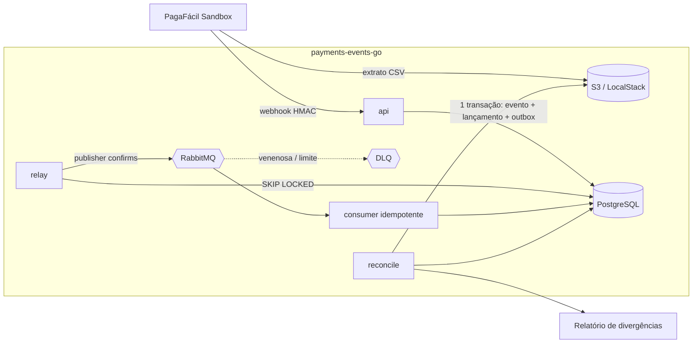

# payments-events-go


Processador de webhooks de pagamento em Go: recebe eventos assinados, registra cada centavo **uma única vez** num ledger, publica eventos de integração sem perda (transactional outbox) e concilia o extrato diário do provedor com o ledger.

## O problema

O **PagaFácil Sandbox** (provedor de pagamentos fictício) avisa o lojista de cada captura e estorno por webhook e deposita, todo dia, o extrato de liquidação num bucket S3. Para o lojista, três coisas não podem acontecer:

1. **Crédito em dobro.** O provedor reenvia webhooks quando não recebe resposta a tempo, às vezes em paralelo. Cada reenvio processado vira dinheiro fantasma no saldo.
2. **Evento perdido entre sistemas.** O lançamento é gravado, mas o financeiro e o saldo nunca ficam sabendo (ou o contrário).
3. **Divergência silenciosa.** O provedor pagou 30,00 e o ledger registrou 25,00, ou um webhook nunca chegou, e ninguém percebe até o fechamento do mês.

Este serviço resolve os três: idempotência garantida pelo banco, outbox transacional com retry e DLQ, e um job de conciliação que aponta o que está faltando, sobrando ou divergente.

## Arquitetura

Hexagonal, num binário com subcomandos (`api`, `relay`, `consumer`, `reconcile`, `migrate`).



```
cmd/payments/              composição e subcomandos
internal/domain/           regras puras: evento, lançamento, conciliação, dinheiro
internal/app/              casos de uso e portas (interfaces)
internal/adapter/          httpapi, postgres (+ migrations), rabbitmq, objectstore (S3), csvstatement, reportout
internal/platform/         config por ambiente, observabilidade (slog, OpenTelemetry)
internal/testinfra/        contêineres para testes de integração (build tag integration)
docs/                      design doc, ADRs, roteiros e observabilidade
```

Detalhes no [design doc](docs/design-doc.md).

## Como rodar

Pré-requisitos: Docker com Compose v2, `make`, `openssl` e `curl`. Go 1.26+ só para desenvolver.

```bash
cp .env.example .env
make up          # Postgres, RabbitMQ, LocalStack (S3), migrate, api, relay, consumer
make seed        # webhooks de exemplo + extrato do provedor no S3
make reconcile   # concilia o extrato de 2026-11-20 com o ledger
```

Saída esperada do `make reconcile` (resumo):

```
Conciliadas                     1
Divergências: faltando no ledger    1
Divergências: sobrando no ledger    1
Divergências: valor divergente      1
```

Enviar um webhook à mão:

```bash
./scripts/send-webhook.sh evt_manual_1 payment.captured txn_manual_1 pay_manual_1 9990
./scripts/send-webhook.sh evt_manual_1 payment.captured txn_manual_1 pay_manual_1 9990   # {"status":"duplicate"}
```

Outros alvos: `make up-observability` (Jaeger em http://localhost:16687 e Prometheus em http://localhost:9095), `make ps`, `make logs`, `make down`, `make clean`, `make help`. Para ligar a API à rede compartilhada do ecossistema: `make up-portfolio`.

| Serviço | Endereço local |
| --- | --- |
| API (webhook, `/metrics`, `/healthz`, `/readyz`) | http://localhost:8085 |
| RabbitMQ UI | http://localhost:15673 |
| PostgreSQL | localhost:5434 |
| LocalStack (S3) | http://localhost:4567 |

As portas evitam colisão com os outros projetos do portfólio e podem ser trocadas no `.env`.

## Como testar

```bash
make test               # unitários com -race e cobertura (sem Docker)
make test-integration   # PostgreSQL, RabbitMQ e LocalStack reais via testcontainers
make lint               # golangci-lint
make fuzz               # fuzzing do parser de valores
make bench              # benchmarks de assinatura e conciliação
```

Os testes de integração ficam sob a build tag `integration` e são pulados se não houver Docker. Destaques:

- 20 entregas concorrentes do mesmo evento geram exatamente um lançamento.
- 5 relays em paralelo não publicam a mesma mensagem ao mesmo tempo.
- Mensagem venenosa vai direto para a DLQ; falha transitória é reentregue até o limite.
- Teste ponta a ponta: webhook assinado → ledger → outbox → RabbitMQ → projeção → conciliação a partir de um extrato no S3.

## Decisões principais

| Decisão | ADR |
| --- | --- |
| Hexagonal num binário único com subcomandos | [0001](docs/adr/0001-arquitetura-hexagonal-binario-unico.md) |
| Idempotência por `event_id` com constraint única (e `transaction_id` único como segunda defesa) | [0002](docs/adr/0002-idempotencia-por-constraint-unica.md) |
| Transactional outbox com polling, `SKIP LOCKED`, backoff exponencial e estado `dead` | [0003](docs/adr/0003-transactional-outbox-com-polling.md) |
| RabbitMQ com filas quorum, publisher confirms, `x-delivery-limit` e DLQ | [0004](docs/adr/0004-rabbitmq-quorum-confirms-dlq.md) |
| HMAC-SHA256 com timestamp e janela anti-replay, com rotação de segredos | [0005](docs/adr/0005-assinatura-hmac-e-janela-anti-replay.md) |
| Conciliação por `transaction_id` em período semiaberto UTC | [0006](docs/adr/0006-conciliacao-por-transaction-id.md) |
| Extrato no S3 com endpoint configurável, LocalStack no ambiente local | [0007](docs/adr/0007-extrato-no-s3-com-localstack.md) |
| OpenTelemetry (traces OTLP e métricas Prometheus) e slog | [0008](docs/adr/0008-observabilidade-opentelemetry.md) |
| Testes de integração com testcontainers sob build tag | [0009](docs/adr/0009-testes-de-integracao-com-testcontainers.md) |

Para defender o núcleo numa entrevista: [roteiro de idempotência](docs/roteiros/idempotencia.md) e [roteiro de conciliação](docs/roteiros/conciliacao.md).

## Trade-offs

- **At-least-once em vez de exactly-once.** Cada fronteira tem uma chave estável e uma constraint; o custo é guardar todos os `event_id` e `message_id` (precisa de retenção).
- **Polling no outbox.** Simples e portável, com até 1 s de latência quando ocioso. CDC fica para quando o volume justificar.
- **Sem ordem garantida no broker.** O consumidor de exemplo é comutativo; consumidores que dependem de ordem precisarão de versão por agregado.
- **Backoff do consumidor segura um slot de prefetch.** Bom para o volume atual; atrasos longos pedem filas de retry com TTL.
- **Conciliação em memória.** Cerca de 4 ms para 10 mil linhas; milhões de linhas pedem a comparação no banco.
- **LocalStack fixado em 4.5.0.** Versões novas exigem token de conta; MinIO seria uma alternativa só para S3.

## Próximos passos

- Validar no CI o que não foi exercitado localmente nesta rodada (Docker local saturado): `docker build` da imagem final, subida completa do `docker-compose` com `make up && make seed && make reconcile` e a suíte `make test-integration` com o LocalStack e o teste ponta a ponta na versão final.
- Helm chart e manifests Kubernetes (Deployments, CronJob de conciliação, HPA, probes) e GitOps com ArgoCD.
- Segredos do webhook no Secrets Manager/Vault e notificação S3 → SQS para disparar a conciliação.
- Retenção e particionamento de `processed_events` e `ledger_entries`; limpeza do outbox publicado.
- Casos de divergência com estado e lançamentos de ajuste com aprovação humana.
- API de consulta de saldo (REST com paginação por cursor) e gRPC interno.
- SBOM, assinatura da imagem e Trivy no CI; testes de carga com k6.

## Licença

[MIT](LICENSE)
