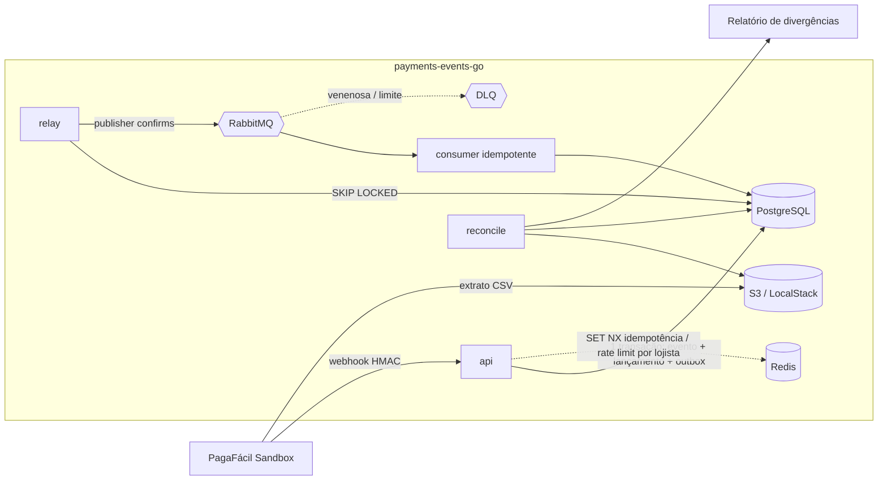

# payments-events-go


Processador de webhooks de pagamento em Go: recebe eventos assinados, registra cada centavo **uma única vez** num ledger, publica eventos de integração sem perda (transactional outbox) e concilia o extrato diário do provedor com o ledger.

## O problema

O **PagaFácil Sandbox** (provedor de pagamentos fictício) avisa o lojista de cada captura e estorno por webhook e deposita, todo dia, o extrato de liquidação num bucket S3. Para o lojista, três coisas não podem acontecer:

1. **Crédito em dobro.** O provedor reenvia webhooks quando não recebe resposta a tempo, às vezes em paralelo. Cada reenvio processado vira dinheiro fantasma no saldo.
2. **Evento perdido entre sistemas.** O lançamento é gravado, mas o financeiro e o saldo nunca ficam sabendo (ou o contrário).
3. **Divergência silenciosa.** O provedor pagou 30,00 e o ledger registrou 25,00, ou um webhook nunca chegou, e ninguém percebe até o fechamento do mês.

Este serviço resolve os três: idempotência garantida pelo banco, outbox transacional com retry e DLQ, e um job de conciliação que aponta o que está faltando, sobrando ou divergente.

## Arquitetura

Hexagonal, num binário com subcomandos (`api`, `relay`, `consumer`, `watch`, `reconcile`, `retention`, `migrate`, `healthcheck`).



```
cmd/payments/              composição e subcomandos
internal/domain/           regras puras: evento, lançamento, conciliação, dinheiro
internal/app/              casos de uso e portas (interfaces)
internal/adapter/          httpapi, grpcapi, oidcauth, secretstore (Vault e Secrets Manager), postgres (+ migrations),
                           rabbitmq, redisstore, objectstore (S3), sqsqueue, csvstatement, reportout
internal/platform/         config por ambiente, observabilidade (slog, OpenTelemetry)
internal/testinfra/        contêineres para testes de integração (build tag integration)
api/proto/                 contrato gRPC de saldo (código gerado em internal/adapter/grpcapi, `make proto`)
web/                       painel Razão (Vue 3)
deploy/                    chart Helm, manifesto ArgoCD, scheduler e Prometheus (config e alertas)
loadtest/                  carga do webhook com k6
docs/                      design doc, ADRs, roteiros e observabilidade
```

Detalhes no [design doc](docs/design-doc.md).

## Como rodar

Pré-requisitos: Docker com Compose v2, `make`, `openssl` e `curl`. Go 1.26+ só para desenvolver.

```bash
cp .env.example .env
make up          # Postgres, RabbitMQ, Redis, LocalStack (S3), migrate, api, relay, consumer
make seed        # webhooks de exemplo + extrato do provedor no S3
make reconcile   # concilia o extrato de 2026-11-20 com o ledger
```

Saída esperada do `make reconcile` (resumo):

```
Conciliadas                     1
Divergências: faltando no ledger    1
Divergências: sobrando no ledger    1
Divergências: valor divergente      1
```

Enviar um webhook à mão:

```bash
./scripts/send-webhook.sh evt_manual_1 payment.captured txn_manual_1 pay_manual_1 9990
./scripts/send-webhook.sh evt_manual_1 payment.captured txn_manual_1 pay_manual_1 9990   # {"status":"duplicate"}
```

Conciliação automática ([ADR 0012](docs/adr/0012-disparo-automatico-da-conciliacao.md)): o extrato depositado em `settlements/` no bucket gera uma notificação S3 → SQS que o serviço `watcher` (`payments watch`) consome, conciliando o dia uma única vez por versão do objeto. O serviço `scheduler` (crond) roda `payments reconcile --daily` todo dia às 03:00 UTC (`RECONCILE_CRON`) como rede de segurança.

Variantes opcionais do ambiente local: `make up-oidc` (login OIDC em vez do token de dev, [ADR 0013](docs/adr/0013-oidc-pkce-e-papeis-no-caso-de-uso.md)), `make up-secrets` (segredos no Secrets Manager do LocalStack, [ADR 0014](docs/adr/0014-segredos-por-porta-e-rotacao-sem-downtime.md)), `make up-grpc` (gRPC de saldo em `127.0.0.1:9191`, [ADR 0016](docs/adr/0016-grpc-interno-de-saldo-autenticado.md)), `make retention` (política de retenção, [ADR 0015](docs/adr/0015-retencao-sem-perder-idempotencia-nem-razao.md)) e `make loadtest` (k6, ver [loadtest/](loadtest/README.md)).

Outros alvos: `make up-observability` (Jaeger em http://localhost:16687 e Prometheus em http://localhost:9095), `make ps`, `make logs`, `make down`, `make clean`, `make help`. Para ligar a API à rede compartilhada do ecossistema: `make up-portfolio`.

| Serviço | Endereço local |
| --- | --- |
| API (webhook, `/api/v1`, `/metrics`, `/healthz`, `/readyz`) | http://localhost:8085 |
| Painel Razão | http://localhost:8086 |
| RabbitMQ UI | http://localhost:15673 |
| PostgreSQL | localhost:5434 |
| LocalStack (S3 e SQS) | http://localhost:4567 |
| Redis | localhost:6381 |

As portas evitam colisão com os outros projetos do portfólio e podem ser trocadas no `.env`.

## Interface (Razão)

Painel em `web/` (Vue 3, Vuetify 3, TanStack Query, TypeScript estrito) com a identidade **Razão**: o livro-razão aberto, extrato do provedor de um lado e ledger do outro. Sobe com o núcleo (`make up`) em http://localhost:8086; em desenvolvimento entre com `dev-token-ana` ou `dev-token-bruno` (papel `operador`, dois para exercitar a aprovação com quatro olhos) ou `dev-token-carla` (papel `leitor`, só consulta; [ADR 0011](docs/adr/0011-autenticacao-de-operador-e-quatro-olhos.md)). Com `OIDC_ISSUER_URL` o painel entra por OIDC com PKCE e o token de dev deixa de valer; `APP_ENV=production` recusa o token de dev ([ADR 0013](docs/adr/0013-oidc-pkce-e-papeis-no-caso-de-uso.md)).

| Tela | O que faz |
| --- | --- |
| Conciliação | Partida dobrada extrato × ledger com a calha de delta (par ligado, lacuna pontilhada, traço quebrado com o delta), cascata do dia, envio do extrato, execução, filtros e busca. Cada divergência é um caso com estado (aberta, ajuste proposto, justificada, resolvida): justificar com motivo, propor ajuste e aprovar/recusar por outra pessoa. |
| Eventos | Tabela densa com busca (evento, transação, pagamento, lojista) e filtros; o detalhe segue o evento por webhook → ledger → outbox → consumidor, com o payload assinado. |
| DLQ | Mensagens agrupadas por motivo, idade em âmbar crescente, histograma por faixa de idade, reprocessar (confirmação digitada e motivo) e descartar com motivo, em lote. |
| Saldos | Líquido por lojista no ledger × projeção do consumidor, com as mensagens ainda por consumir, e detalhe por pagamento. |

Uma faixa fixa mostra a saúde do pipeline (outbox pendente e mais antigo, publicações por minuto, último consumo, DLQ aberta). Gráficos são SVG próprio (cascata e histograma), sem biblioteca, para ter rótulos com o valor exato e a estética de relatório impresso. Rodar em desenvolvimento: `make web-dev`. Verificação: `make web-check`.

### API de operação

`/api/v1` (`Authorization: Bearer` com token OIDC, ou o token de dev; ações de escrita exigem o papel `operador`, checado no caso de uso, e o `leitor` recebe 403): `GET /events`, `/events/{id}`, `/ledger-entries` (cursor), `/balances/merchants`, `/balances/payments`, `/pipeline`, `/dead-letters`, `POST /dead-letters/{broker|outbox}/{id}/reprocess|discard`, `GET|PUT /statements`, `GET|POST /reconciliation/runs`, `GET /reconciliation/runs/{id}/items`, `GET /cases`, `POST /cases/{id}/explain|adjustments`, `GET /adjustments`, `POST /adjustments/{id}/approve|reject`. Erros em `application/problem+json`. Sem `OIDC_ISSUER_URL` nem `OPERATOR_TOKENS`, a API de operação fica desligada. O saldo também sai por gRPC ([ADR 0016](docs/adr/0016-grpc-interno-de-saldo-autenticado.md)), opt-in por `GRPC_ADDR`.

## Como testar

```bash
make test               # unitários com -race e cobertura (sem Docker)
make test-integration   # PostgreSQL, RabbitMQ e LocalStack reais via testcontainers
make lint               # golangci-lint
make fuzz               # fuzzing do parser de valores
make bench              # benchmarks de assinatura e conciliação
```

Os testes de integração ficam sob a build tag `integration` e são pulados se não houver Docker. Destaques:

- 20 entregas concorrentes do mesmo evento geram exatamente um lançamento.
- 5 relays em paralelo não publicam a mesma mensagem ao mesmo tempo.
- Mensagem venenosa vai direto para a DLQ; falha transitória é reentregue até o limite.
- Teste ponta a ponta: webhook assinado → ledger → outbox → RabbitMQ → projeção → conciliação a partir de um extrato no S3.

## Evidência

```bash
make evidencia
```

Recria a stack do zero (núcleo + Jaeger e Prometheus) e roda o spec Playwright de `e2e/evidencia/`, que grava um
vídeo em `e2e/evidencia/test-results/`. O vídeo mostra, com chamadas reais: webhook com HMAC válido (200), reentrega
idempotente (`duplicate`) respondida pelo Redis e, sem a chave, pelo Postgres, rate limit por lojista (429),
assinatura inválida e timestamp antigo (401), ledger e outbox consultados no Postgres, a
fila e o consumidor no RabbitMQ Management, uma mensagem inválida indo para a DLQ, o extrato enviado ao S3 do
LocalStack, o relatório de conciliação (faltando, sobrando e valor divergente), o trace no Jaeger e as métricas em
`/metrics`. Requer Node 20+.

## Decisões principais

| Decisão | ADR |
| --- | --- |
| Hexagonal num binário único com subcomandos | [0001](docs/adr/0001-arquitetura-hexagonal-binario-unico.md) |
| Idempotência por `event_id` com constraint única (e `transaction_id` único como segunda defesa) | [0002](docs/adr/0002-idempotencia-por-constraint-unica.md) |
| Transactional outbox com polling, `SKIP LOCKED`, backoff exponencial e estado `dead` | [0003](docs/adr/0003-transactional-outbox-com-polling.md) |
| RabbitMQ com filas quorum, publisher confirms, `x-delivery-limit` e DLQ | [0004](docs/adr/0004-rabbitmq-quorum-confirms-dlq.md) |
| HMAC-SHA256 com timestamp e janela anti-replay, com rotação de segredos | [0005](docs/adr/0005-assinatura-hmac-e-janela-anti-replay.md) |
| Conciliação por `transaction_id` em período semiaberto UTC | [0006](docs/adr/0006-conciliacao-por-transaction-id.md) |
| Extrato no S3 com endpoint configurável, LocalStack no ambiente local | [0007](docs/adr/0007-extrato-no-s3-com-localstack.md) |
| OpenTelemetry (traces OTLP e métricas Prometheus) e slog | [0008](docs/adr/0008-observabilidade-opentelemetry.md) |
| Testes de integração com testcontainers sob build tag | [0009](docs/adr/0009-testes-de-integracao-com-testcontainers.md) |
| Redis como atalho de idempotência (o Postgres segue como garantia) e limite por lojista, fail-open | [0010](docs/adr/0010-redis-atalho-de-idempotencia-e-rate-limit.md) |
| Painel de operação: token por operador com papel (leitor ou operador) e ajustes de ledger com aprovação de outra pessoa | [0011](docs/adr/0011-autenticacao-de-operador-e-quatro-olhos.md) |
| Conciliação disparada por notificação S3 → SQS (idempotente por versão do objeto) e agenda diária por cron | [0012](docs/adr/0012-disparo-automatico-da-conciliacao.md) |
| OIDC com PKCE (Keycloak do platform-edge) para operadores; papéis checados no caso de uso; token só em dev | [0013](docs/adr/0013-oidc-pkce-e-papeis-no-caso-de-uso.md) |
| Segredos do webhook e do banco por porta (Vault e Secrets Manager), com rotação sem downtime | [0014](docs/adr/0014-segredos-por-porta-e-rotacao-sem-downtime.md) |
| Retenção: ledger imutável (gatilho) e exportado por mês, payloads arquivados em partições, outbox publicado limpo | [0015](docs/adr/0015-retencao-sem-perder-idempotencia-nem-razao.md) |
| gRPC interno de saldo (só leitura) com token OIDC, papel checado no caso de uso e TLS obrigatório em produção | [0016](docs/adr/0016-grpc-interno-de-saldo-autenticado.md) |
| Deploy em Kubernetes com Helm e ArgoCD, sincronização manual e revisão fixada por tag | [0017](docs/adr/0017-deploy-em-kubernetes-com-helm-e-argocd.md) |
| Cadeia de suprimentos no CI: SBOM (syft) e scan (Trivy) por digest; assinatura pendente | [0018](docs/adr/0018-supply-chain-no-ci-sbom-e-scan.md) |

Padrões de projeto e SOLID com os trechos reais do código: [docs/arquitetura/padroes.md](docs/arquitetura/padroes.md).

Para defender o núcleo numa entrevista: [roteiro de idempotência](docs/roteiros/idempotencia.md) e [roteiro de conciliação](docs/roteiros/conciliacao.md).

## Trade-offs

- **At-least-once em vez de exactly-once.** Cada fronteira tem uma chave estável e uma constraint; o custo é guardar todos os `event_id` e `message_id` para sempre; a retenção arquiva o peso (payload, outbox publicado) e nunca a chave ([ADR 0015](docs/adr/0015-retencao-sem-perder-idempotencia-nem-razao.md)).
- **Polling no outbox.** Simples e portável, com até 1 s de latência quando ocioso. CDC fica para quando o volume justificar.
- **Sem ordem garantida no broker.** O consumidor de exemplo é comutativo; consumidores que dependem de ordem precisarão de versão por agregado.
- **Backoff do consumidor segura um slot de prefetch.** Bom para o volume atual; atrasos longos pedem filas de retry com TTL.
- **Conciliação em memória.** Cerca de 4 ms para 10 mil linhas; milhões de linhas pedem a comparação no banco.
- **LocalStack fixado em 4.5.0.** Versões novas exigem token de conta; MinIO seria uma alternativa só para S3.

## Próximos passos

Só o que falta de fato. O que foi escrito e ainda não rodou contra o serviço real está marcado como tal.

**Validar fora do CI (código pronto, nunca exercitado no alvo)**

- OIDC contra o Keycloak real: criar no realm `edge` do platform-edge o client público `payments-razao` (PKCE, redirect `/callback`) e alinhar o `KC_HOSTNAME` para o emissor ser alcançável do contêiner da API ([ADR 0013](docs/adr/0013-oidc-pkce-e-papeis-no-caso-de-uso.md)). Também falta provar o gRPC com um token de conta de serviço real.
- Segredos contra um Vault e um Secrets Manager reais (hoje só dublês HTTP e `docker compose config`), e configurar no Postgres as duas credenciais da rotação da senha do banco ([ADR 0014](docs/adr/0014-segredos-por-porta-e-rotacao-sem-downtime.md)).
- Chart Helm e manifesto ArgoCD em um cluster: o CI só renderiza ([ADR 0017](docs/adr/0017-deploy-em-kubernetes-com-helm-e-argocd.md)). O painel (`web/`) ainda não está no chart.
- Teste de carga: rodar o k6 num ambiente de teste e fixar limiares a partir da medição ([loadtest/](loadtest/README.md)); os alertas do Prometheus também são limiares iniciais.

**Decisões do autor**

- Prazo de guarda dos dados: nenhum prazo legal foi definido, os prazos da retenção são configuráveis ([ADR 0015](docs/adr/0015-retencao-sem-perder-idempotencia-nem-razao.md)). Se o volume pedir, particionar o próprio `ledger_entries` exige uma tabela de chaves.
- Assinatura da imagem (cosign): exige `id-token` no workflow e um registro, e fica com o autor ([ADR 0018](docs/adr/0018-supply-chain-no-ci-sbom-e-scan.md)).
- Promoção por tag no ArgoCD e a política de quem cria a tag ([ADR 0017](docs/adr/0017-deploy-em-kubernetes-com-helm-e-argocd.md)).

**Previsto no design doc e não feito**

- `LISTEN/NOTIFY` no relay para reduzir a latência do outbox, e CDC se o volume justificar.
- Conciliação em SQL para volumes grandes (hoje em memória).
- Testes de mutação no domínio.
- Alerta para o job de conciliação com divergência (código 3); no Kubernetes, use a falha do CronJob.
- Screenshots do painel em `docs/screenshots/` e vídeo de evidência pelos front-ends.

## Licença

[MIT](LICENSE)
