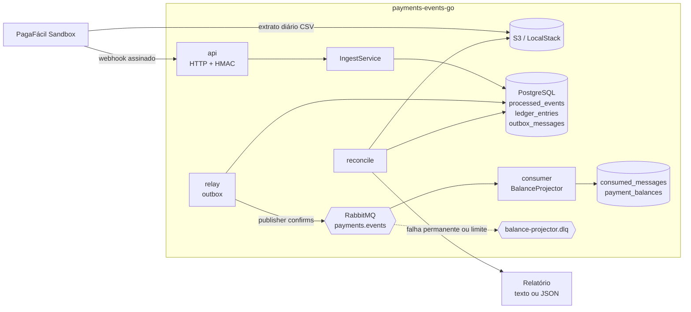
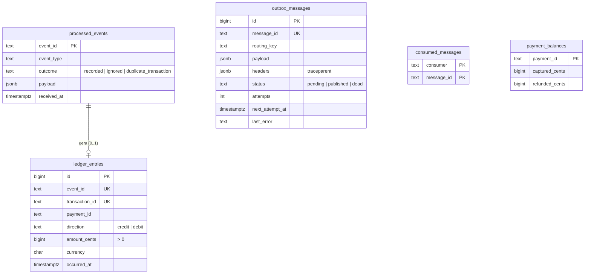

# Design doc: processador de eventos de pagamento

- Autor: Johnny Santos
- Status: fundação implementada
- Última revisão: 2026-11-21

## 1. Contexto

O **PagaFácil Sandbox** é um provedor de pagamentos fictício. Ele avisa o lojista de cada captura e estorno por webhook e, uma vez por dia, deposita num bucket S3 o extrato de liquidação com tudo o que foi efetivamente pago.

O lojista precisa de um ledger confiável: cada centavo capturado deve aparecer uma vez, os outros sistemas (financeiro, notificações, saldo) precisam ser avisados, e qualquer diferença entre o que o provedor pagou e o que o ledger registrou precisa ser apontada no dia seguinte.

Os riscos são clássicos de integração financeira: webhooks repetidos ou concorrentes, eventos forjados, perda de eventos entre banco e fila, consumidores que processam duas vezes e divergências que ninguém percebe.

## 2. Objetivos e não-objetivos

**Objetivos**

1. Receber webhooks autenticados (HMAC-SHA256) e rejeitar replays fora de uma janela de tempo.
2. Registrar cada evento financeiro **uma única vez** no ledger, mesmo com reentregas concorrentes.
3. Publicar um evento de integração para cada lançamento sem *dual write* (transactional outbox), com retry exponencial e DLQ.
4. Oferecer um consumidor de exemplo idempotente.
5. Conciliar o extrato diário com o ledger e classificar divergências (faltando, sobrando, valor divergente).
6. Ser observável (logs, métricas, traces) e rodar localmente com um comando.

**Não-objetivos (nesta fase)**

- Multi-moeda com câmbio, taxas e repasses (split).
- Correção automática de divergências.
- Deploy em Kubernetes e Helm (ver plano de evolução).
- Interface gráfica.
- Gestão de segredos em cofre (os segredos vêm de variáveis de ambiente).

## 3. Arquitetura

Arquitetura hexagonal (ADR [0001](adr/0001-arquitetura-hexagonal-binario-unico.md)): domínio puro, casos de uso com portas, adaptadores na borda e um binário com subcomandos.



| Camada | Pacote | Responsabilidade |
| --- | --- | --- |
| Domínio | `internal/domain` | `Event`, `LedgerEntry`, `Reconcile`, parsing de valores |
| Aplicação | `internal/app` | `IngestService`, `Relay`, `BalanceProjector`, `ReconcileService`, portas |
| Adaptadores de entrada | `internal/adapter/httpapi` | webhook, assinatura, health, `/metrics` |
| Adaptadores de saída | `internal/adapter/postgres`, `rabbitmq`, `objectstore`, `csvstatement`, `reportout` | persistência, broker, S3, CSV, relatório |
| Plataforma | `internal/platform/config`, `observability` | variáveis de ambiente, OpenTelemetry, slog |
| Composição | `cmd/payments` | subcomandos e injeção de dependências |

## 4. Modelo de dados



- Valores sempre em centavos (`bigint`), com `CHECK (amount_cents > 0)`; a direção carrega o sinal.
- Ledger append-only: correções são novos lançamentos.
- Índices: `ledger_entries (occurred_at)` para a conciliação, `outbox_messages (next_attempt_at, id) WHERE status = 'pending'` (parcial) para o relay.
- Migrations SQL versionadas e embutidas no binário (`payments migrate`), aplicadas sob `pg_advisory_lock` e registradas em `schema_migrations`.

**Contrato do webhook (entrada)**

```json
{
  "id": "evt_01",
  "type": "payment.captured",
  "created_at": "2026-11-20T12:00:00Z",
  "data": {"transaction_id": "txn_01", "payment_id": "pay_01", "amount": 15000, "currency": "BRL"}
}
```

**Evento de integração (saída, `ledger.entry_recorded`, versão 1)**

```json
{
  "schema_version": 1, "event_id": "evt_01", "transaction_id": "txn_01", "payment_id": "pay_01",
  "direction": "credit", "amount_cents": 15000, "currency": "BRL", "occurred_at": "2026-11-20T12:00:00Z"
}
```

**Extrato (CSV no S3)**: `transaction_id,payment_id,type,amount,currency,occurred_at`, com `type` em `capture|refund` e `amount` decimal com ponto.

## 5. Fluxos principais

### 5.1 Recebimento do webhook

```mermaid
sequenceDiagram
    autonumber
    participant P as PagaFácil Sandbox
    participant H as WebhookHandler
    participant S as IngestService
    participant DB as PostgreSQL
    P->>H: POST /webhooks/pagafacil + PagaFacil-Signature
    H->>H: limita corpo (1 MiB), verifica HMAC e janela de 5 min
    alt assinatura inválida ou fora da janela
        H-->>P: 401 problem+json
    end
    H->>S: Ingest(evento, corpo bruto)
    S->>S: valida contrato, deriva lançamento e mensagem
    S->>DB: BEGIN; INSERT processed_events ON CONFLICT DO NOTHING
    alt event_id já existe
        DB-->>S: 0 linhas (ROLLBACK)
        S-->>H: duplicate
        H-->>P: 200 {"status":"duplicate"}
    else novo
        S->>DB: INSERT ledger_entries; INSERT outbox_messages; COMMIT
        H-->>P: 200 {"status":"recorded"}
    end
```

### 5.2 Publicação pelo outbox

```mermaid
sequenceDiagram
    autonumber
    participant R as Relay
    participant DB as PostgreSQL
    participant MQ as RabbitMQ
    loop a cada OUTBOX_POLL_INTERVAL (imediato se o lote veio cheio)
        R->>DB: BEGIN; SELECT pendentes vencidas FOR UPDATE SKIP LOCKED LIMIT 100
        loop cada mensagem
            R->>MQ: publish persistente (MessageId = event_id, traceparent)
            alt confirm (ack)
                R->>DB: status = published
            else erro e tentativas < máximo
                R->>DB: attempts+1, next_attempt_at = agora + backoff exponencial com jitter
            else esgotou
                R->>DB: status = dead
            end
        end
        R->>DB: COMMIT
    end
```

### 5.3 Consumo idempotente

```mermaid
sequenceDiagram
    autonumber
    participant MQ as balance-projector (quorum)
    participant C as Consumer
    participant DB as PostgreSQL
    participant DLQ as balance-projector.dlq
    MQ->>C: entrega (x-delivery-count)
    C->>C: decodifica e valida contrato
    alt contrato inválido (erro permanente)
        C->>MQ: nack sem requeue
        MQ->>DLQ: dead-letter
    else válido
        C->>DB: BEGIN; INSERT consumed_messages ON CONFLICT DO NOTHING
        alt já consumida
            C->>DB: COMMIT (sem efeito)
        else nova
            C->>DB: UPSERT payment_balances; COMMIT
        end
        C->>MQ: ack
    end
    Note over C,MQ: erro transitório: espera backoff e nack com requeue;<br/>após x-delivery-limit o broker manda para a DLQ
```

### 5.4 Conciliação

Detalhado em [roteiros/conciliacao.md](roteiros/conciliacao.md): o job lê o CSV do S3, carrega os lançamentos do período `[from, to)` e roda `domain.Reconcile`, que devolve as divergências ordenadas e os totais líquidos dos dois lados.

## 6. Falhas e como são tratadas

| Falha | Efeito | Tratamento |
| --- | --- | --- |
| Reentrega do mesmo webhook (inclusive concorrente) | risco de crédito duplicado | PK em `event_id` + `ON CONFLICT`; responde 200 `duplicate` |
| Dois eventos para a mesma transação | risco de crédito duplicado | UNIQUE em `transaction_id`; auditado como `duplicate_transaction` |
| Assinatura inválida ou replay antigo | evento forjado | 401 sem detalhes; métrica `invalid_signature`/`stale_timestamp` |
| Contrato violado (valor zero, moeda inválida) | dado corrompido no ledger | 422; nada é gravado |
| Banco indisponível no webhook | evento não registrado | 500; o provedor reenvia |
| Processo cai entre commit e resposta | provedor reenvia | reentrega vira `duplicate` |
| Broker indisponível | evento de integração atrasa | mensagem fica no outbox; retry exponencial com jitter; `outbox_retries_total` |
| Broker fora por muito tempo | mensagem não sai | após `OUTBOX_MAX_ATTEMPTS`, `status = dead` e `outbox_dead_total`; reprocessar com `UPDATE ... SET status='pending'` |
| Relay cai após confirm e antes do commit | publicação duplicada | consumidor deduplica por `message_id` |
| Mensagem venenosa | laço de reentrega | erro permanente vai direto para a DLQ |
| Falha transitória no consumidor | atraso | backoff e requeue até `x-delivery-limit`, depois DLQ |
| Extrato mal formado | relatório enganoso | job aborta com número da linha, código 1 |
| Webhook perdido pelo provedor | ledger incompleto | conciliação aponta `missing_in_ledger` |

## 7. Segurança

- **Autenticação do webhook**: HMAC-SHA256 sobre `timestamp.corpo`, comparação em tempo constante, janela de 5 minutos, rotação com múltiplos segredos (ADR [0005](adr/0005-assinatura-hmac-e-janela-anti-replay.md)).
- **Entrada**: corpo limitado a 1 MiB, JSON tolerante a campos novos, validação de domínio antes de gravar; erros em RFC 9457 sem vazar detalhes internos.
- **Servidor HTTP**: `ReadHeaderTimeout`, `ReadTimeout`, `WriteTimeout` e `IdleTimeout` explícitos (mitiga slowloris).
- **SQL**: somente consultas parametrizadas (pgx); nenhuma concatenação de entrada.
- **Segredos**: só por variáveis de ambiente; `.env` fora do Git; valores de desenvolvimento marcados como `dev-only`.
- **Contêiner**: imagem distroless, usuário não-root, binário estático, base fixada por digest.
- **Cadeia de suprimentos**: `govulncheck` e `golangci-lint` (com `gosec`) no CI; actions fixadas por versão major.
- **Dados**: o payload bruto do webhook é guardado para auditoria e não contém dados de cartão (o provedor fictício não envia PAN).

## 8. Observabilidade

Detalhes em [observabilidade.md](observabilidade.md) e ADR [0008](adr/0008-observabilidade-opentelemetry.md).

- **Logs**: JSON via `slog`, com `service`, `trace_id` e `span_id`.
- **Métricas** (`/metrics`): `webhook_requests_total{outcome}`, `http_server_request_duration_seconds`, `outbox_published_total`, `outbox_retries_total`, `outbox_dead_total`, `outbox_publish_lag_seconds`, `consumer_messages_total{outcome}`, runtime do Go e métricas do RabbitMQ (`:15692`).
- **Traces**: OTLP para o Jaeger; o mesmo trace cobre webhook → transação → relay → publicação → consumo.
- **Sinais sugeridos para alerta**: `outbox_dead_total` > 0; p99 de `outbox_publish_lag_seconds` > 30 s; taxa de `invalid_signature` acima do normal; profundidade da DLQ > 0; job de conciliação com código 3.

## 9. Alternativas consideradas

| Tema | Escolha | Alternativas | ADR |
| --- | --- | --- | --- |
| Estrutura | hexagonal, binário único | camadas simples, um binário por processo | [0001](adr/0001-arquitetura-hexagonal-binario-unico.md) |
| Idempotência | constraint única no Postgres | SELECT antes do INSERT, Redis, SERIALIZABLE | [0002](adr/0002-idempotencia-por-constraint-unica.md) |
| Banco → fila | outbox com polling e SKIP LOCKED | CDC (Debezium), LISTEN/NOTIFY, publicar após commit | [0003](adr/0003-transactional-outbox-com-polling.md) |
| Broker | RabbitMQ quorum + confirms + DLQ | filas de retry com TTL, Kafka | [0004](adr/0004-rabbitmq-quorum-confirms-dlq.md) |
| Autenticação | HMAC + timestamp | mTLS, assinatura assimétrica, allowlist de IP | [0005](adr/0005-assinatura-hmac-e-janela-anti-replay.md) |
| Conciliação | transaction_id, período UTC, função pura | SQL FULL OUTER JOIN, casamento por valor | [0006](adr/0006-conciliacao-por-transaction-id.md) |
| Extrato | S3 com endpoint configurável, LocalStack | MinIO, disco, SFTP | [0007](adr/0007-extrato-no-s3-com-localstack.md) |
| Observabilidade | OpenTelemetry + Prometheus + slog | client_golang, zap, APM proprietário | [0008](adr/0008-observabilidade-opentelemetry.md) |
| Testes | testcontainers sob build tag | compose de testes, mocks | [0009](adr/0009-testes-de-integracao-com-testcontainers.md) |

## 10. Plano de evolução

0. **Validação pendente da fundação**: `docker build` da imagem final, subida completa do compose (`make up && make seed && make reconcile`) e a suíte de integração com LocalStack e o e2e na versão final ficam para o CI; localmente foram validados os testes unitários, o lint, `docker compose config`, o `helm lint` e, em versão anterior, os testes de integração de PostgreSQL e RabbitMQ.
1. **Kubernetes e Helm**: chart com Deployments para `api`, `relay` e `consumer`, CronJob para `reconcile`, probes em `/healthz` e `/readyz`, HPA na API e PodDisruptionBudget; GitOps com ArgoCD.
2. **Segredos**: Secrets Manager (LocalStack localmente) ou Vault para `WEBHOOK_SECRETS` e credenciais.
3. **Chegada do extrato**: notificação S3 → SQS para disparar a conciliação assim que o arquivo chega.
4. **Outbox**: `LISTEN/NOTIFY` para reduzir latência; CDC se o volume justificar; limpeza de mensagens publicadas.
5. **Retenção**: particionamento mensal de `processed_events` e `ledger_entries`.
6. **Conciliação**: casos de divergência com estado, lançamentos de ajuste com aprovação e comparação em SQL para volumes grandes.
7. **APIs**: consulta de saldo e de lançamentos (REST com paginação por cursor) e uma API gRPC interna para outros serviços.
8. **Segurança de supply chain**: SBOM, assinatura da imagem (cosign) e scan com Trivy no CI.
9. **Testes**: carga com k6 no webhook e testes de mutação no domínio.
