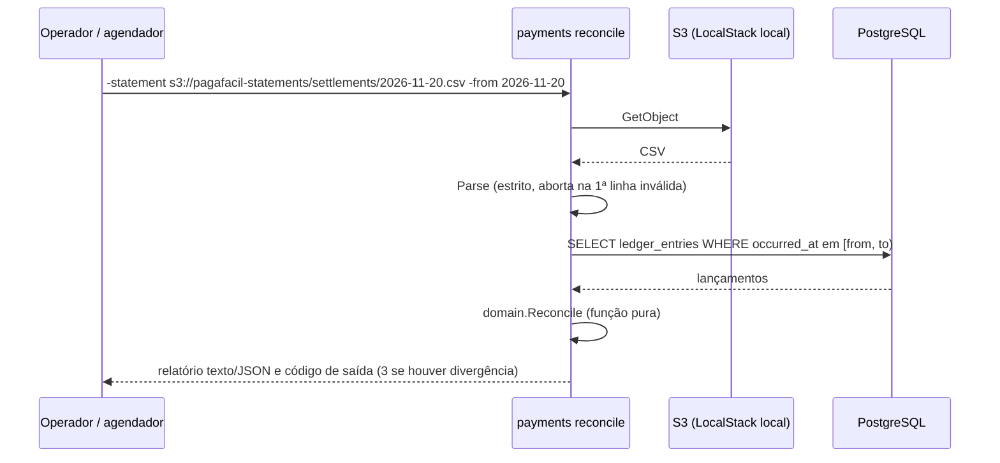

# Roteiro: conciliação

Como o job compara o extrato de liquidação do PagaFácil Sandbox com o ledger do lojista e aponta cada diferença, com que garantias e com quais limites.

## 1. O problema

Webhooks são o caminho rápido, não o caminho garantido. O provedor pode desistir de entregar, um deploy pode rejeitar eventos por algumas horas, um bug pode lançar o valor errado. O extrato diário que o provedor deposita no S3 é a fonte de verdade financeira. Conciliar é responder, para cada dia:

- **faltando**: o provedor liquidou e o ledger não tem (`missing_in_ledger`);
- **sobrando**: o ledger tem e o provedor não liquidou (`missing_in_statement`);
- **valor divergente**: os dois têm, com valor, moeda ou direção diferentes (`amount_mismatch`);
- **duplicada no extrato**: a mesma transação listada duas vezes (`duplicate_in_statement`).

## 2. Fluxo

## 3. Decisões que sustentam o resultado

1. **Chave = `transaction_id`.** Identifica a operação financeira. `payment_id` não serve (um pagamento tem captura e estornos); valor+data é ambíguo.
2. **Período semiaberto `[from, to)` em UTC.** Evita contar a meia-noite em dois dias. O lançamento usa o `occurred_at` informado pelo provedor, a mesma fonte de tempo do extrato, então não há divergência artificial por fuso ou por atraso do webhook.
3. **Centavos em `int64` e parser decimal estrito.** `"150.00"` vira `15000` sem passar por `float64`. Vírgula, três casas, sinal e notação científica são rejeitados. Coberto por testes de tabela e por fuzzing (ida e volta formata/parse).
4. **Extrato inválido aborta.** Pular uma linha ruim produziria um relatório "limpo" e errado. O erro diz a linha.
5. **Função pura e determinística.** `domain.Reconcile(period, statement, ledger)` não faz I/O e ordena o resultado por tipo e transação. Testar é montar duas listas.
6. **Fonte do extrato atrás de uma porta.** `StatementReader` lê `s3://...` pelo SDK da AWS com endpoint configurável (LocalStack local, AWS real em produção) ou um caminho local para reprocessar arquivos.

## 4. Exemplo com o seed local

`make up && make seed && make reconcile` gera:

| Transação | Ledger | Extrato | Resultado |
| --- | --- | --- | --- |
| txn_demo_001 | captura 150,00 | captura 150,00 | conciliada |
| txn_demo_002 | estorno 25,00 | estorno 30,00 | valor divergente |
| txn_demo_003 | captura 80,00 | ausente | sobrando no ledger |
| txn_demo_004 | ausente | captura 42,00 | faltando no ledger |

## 5. Alternativas e trade-offs

| Alternativa | Trade-off |
| --- | --- |
| Conciliar em SQL (tabela temporária + `FULL OUTER JOIN`) | escala para milhões de linhas; regra menos legível e mais difícil de testar sem banco |
| Merge join em streaming (extrato e ledger ordenados por chave) | memória constante; exige ordenação do arquivo do provedor |
| Correção automática (criar lançamento faltante) | fecha o ciclo, mas decide sobre dinheiro sem revisão humana; fica para depois, com aprovação |
| Tolerância de valor (ex.: ±1 centavo) | absorve arredondamento de taxas; aqui não há taxas, então tolerância zero |

Hoje o job carrega o período em memória: 10 mil linhas levam cerca de 4 ms (`make bench`). Um dia de um lojista médio cabe com folga; o limite aparece na casa dos milhões.

## 6. Perguntas que um entrevistador faria

**Por que não confiar só nos webhooks?**
Porque eles são *best effort* do lado do provedor: há limite de tentativas. A conciliação é o controle que detecta o que escapou, inclusive bugs nossos.

**Como você trata uma transação que aconteceu às 23:59 e foi liquidada no dia seguinte?**
Os dois lados usam o `occurred_at` da operação informado pelo provedor, não a data de liquidação nem a hora em que o webhook chegou. A transação cai no mesmo dia nos dois lados. Se o extrato listasse por data de liquidação, eu conciliaria por uma janela de alguns dias e marcaria como "pendente" o que ainda pode chegar.

**Divergência de moeda conta como valor divergente?**
Sim, e o detalhe diz qual campo diverge (`valor`, `moeda` ou `direção`). Para quem opera, é a mesma ação: investigar aquela transação.

**O que acontece se o extrato tiver uma linha quebrada?**
O job falha com `invalid statement: line N: ...` e código 1. Um relatório parcial pareceria correto e esconderia divergências. A correção é pedir o arquivo de novo ao provedor; o bucket tem versionamento, então o arquivo anterior fica preservado.

**Por que o código de saída 3?**
Para o agendador (cron, Kubernetes CronJob, Airflow) distinguir "rodou e achou divergências" (alerta para o financeiro) de "falhou" (alerta para engenharia, código 1).

**Rodar duas vezes é seguro?**
Sim. O job só lê. Por isso pode ser reexecutado depois de corrigir um webhook perdido, para confirmar que a divergência sumiu.

**E se o volume crescer cem vezes?**
Primeiro passo: empurrar a comparação para o banco (carregar o extrato numa tabela de staging com `COPY` e fazer `FULL OUTER JOIN` por `transaction_id`). Segundo: particionar `ledger_entries` por mês para o filtro de período ler só a partição certa.

**Como evoluiria isso para corrigir automaticamente?**
Cada divergência vira um caso com estado (aberto, em análise, resolvido). "Faltando" com evento recuperável pela API do provedor pode gerar o lançamento com aprovação de um humano; as demais seguem para análise. Lançamentos de ajuste nunca editam o original, porque o ledger é append-only.
